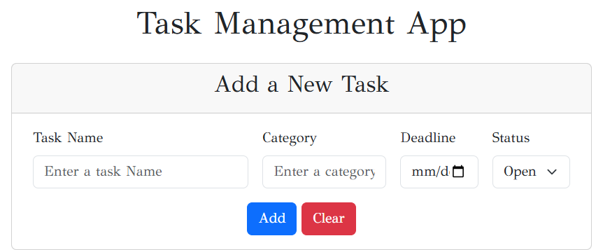
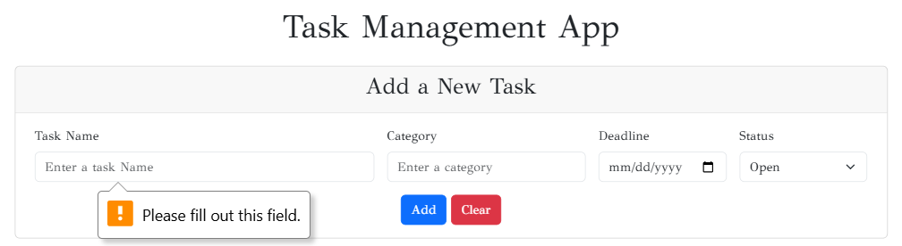
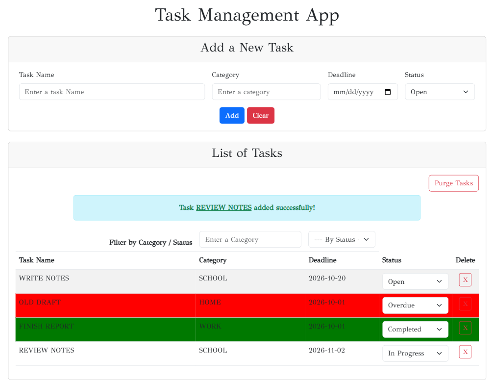
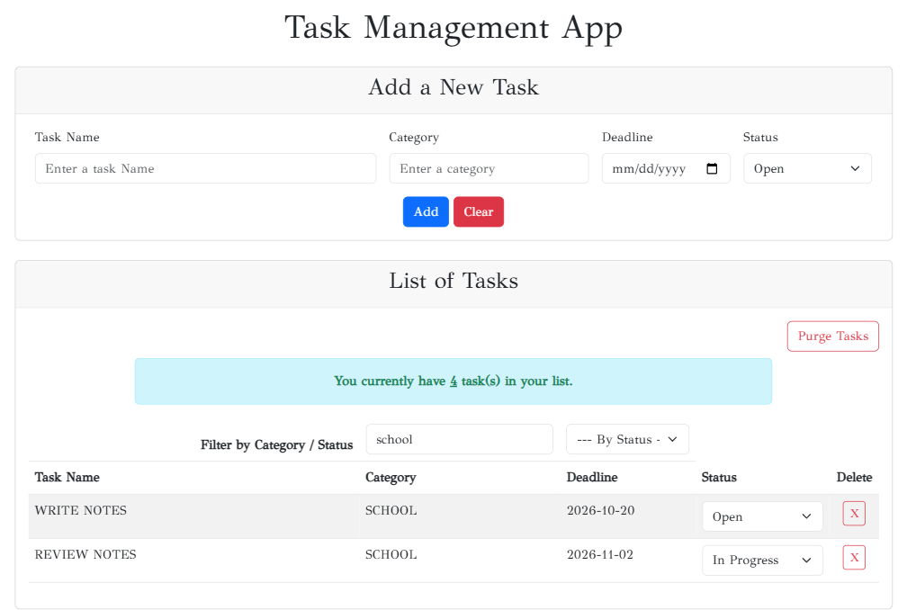

# SBA 4: Task Management App

## By [Mamadou Moussa Balde](https://www.linkedin.com/in/2mb/)

This is a single page, `index.html`, that stores a task list in the browser. There is no server and no install step. Bootstrap 5.3 and the GFS Didot font load from the internet, so the page needs a network connection. Open `index.html` in a browser.

The tab title is "SBA 4: Task Management App". The page heading is "Task Management App", and the body uses GFS Didot. The footer is empty. Tasks are saved in `localStorage` under the key `taskList`.

## Adding a task

The form has Task Name, Category, Deadline, and Status. Status starts on Open. The other choices are In Progress, Completed, and Overdue. All four fields are required. With the fields empty, Add stays on the page and the browser shows "Please fill out this field." The list card stays hidden until a task is saved.

A saved name and category are stored in uppercase. The deadline is stored as `yyyy-mm-dd`. Add then resets the form, and a blue banner reads `Task NAME added successfully!` with the name underlined. Clear resets the form and leaves the saved list as it is.

## The list

Each row shows the name, category, deadline, a status menu, and an X button. Overdue rows are red. Completed rows are green. Open and In Progress rows use the striped table.

A deadline earlier than today's UTC date is changed to Overdue when the status is Open or In Progress. On this run that UTC date was 2026-10-14.

- WRITE NOTES, School, 2026-10-20, stayed Open.
- OLD DRAFT, Home, 2026-10-01, was added as Open and stored as Overdue.
- FINISH REPORT, Work, 2026-10-01, was added as Completed and stayed Completed.
- REVIEW NOTES, School, 2026-11-02, stayed In Progress.

A task dated on the UTC date itself stays at the status you chose: DUE TODAY, dated 2026-10-14 and added as Open, stayed Open. Choosing Overdue on a future task leaves it Overdue. Choosing Open on a past Completed task makes the refresh mark that task Overdue.

Reloading the page keeps the tasks and replaces the success banner with `You currently have 4 task(s) in your list.` The number is the number of saved tasks. While the success sentence is still in the banner, filtering, deleting, or changing a status leaves that sentence in place.

Each task id comes from `Date.getTime()`. Two tasks created in the same millisecond shared one id. Changing the status of that id changed both rows, and deleting it removed both rows. Deleting a task that had its own id removed only that row.

Purge Tasks saves an empty list, clears the banner, and hides the list card again.

## Filters

The category box matches any category that contains the typed text, ignoring case. The status menu matches the selected status. Both have to match. Typing `school` left WRITE NOTES and REVIEW NOTES on screen. The banner still said 4 task(s), because the count uses the full saved list.

### Reflection

#### Challenges faced during the project.
The main challenge I encountered is the implementation of the following functions: 
* getTasksFromLocalStorage() 
* checkOverdueTasks() 
* The continuous refactoring of refreshTaskListAnddisplay(), 
* updateTaskStatus()
* The interaction between filterTaskList() and the index.html page

#### How I approached solving those challenges.
The approach I used for fixing these challenges: I coded the first version of the function by referring to the resources provided by the class and tested it. Usually it worked well, but in some cases I asked AI to evaluate my code and give me feedback. Some feedback was necessary, so I added it myself, and sometimes I skipped it if it was not a requirement of the project.

#### What I would improve if given more time.
If I had more time, I would add a new button to convert the form into a pop-up form so when the user clicks on the button the pop-up opens. I would also add a new feature to delete multiple tasks in one click.
